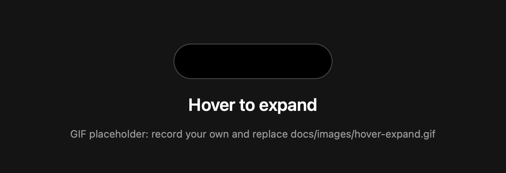
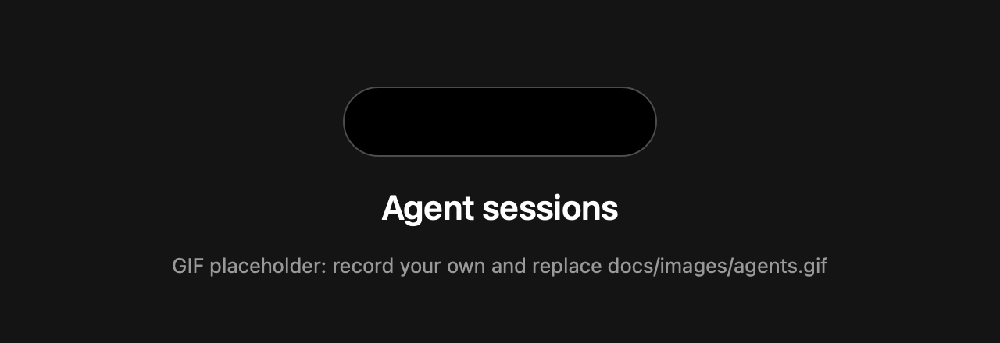
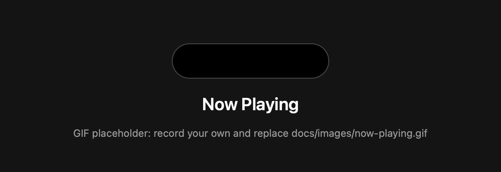
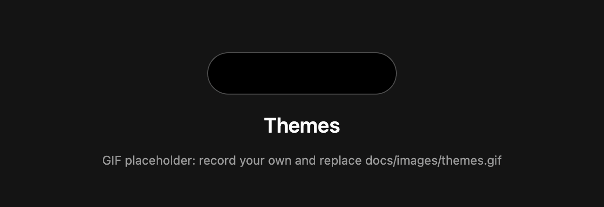
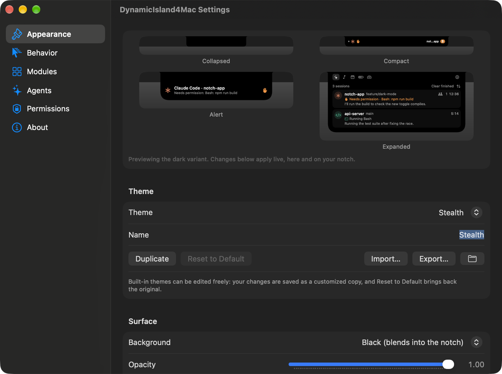

# DynamicIsland4Mac

An open-source Dynamic Island for MacBooks with a notch, built to be forked, built in Xcode
and made your own. It shows what's playing, your battery, your next meeting, files you're
holding, and **every Claude Code and Codex session running on your Mac**, with alerts when
one needs you. Every visual choice is a theme setting.

<!-- GIF placeholders: record with your own screen and drop them in docs/images/. -->
| | |
|---|---|
|  |  |
|  |  |



## Contents

- [Features](#features)
- [Requirements](#requirements)
- [Build it (fresh fork)](#build-it-fresh-fork)
- [First launch](#first-launch)
- [Permissions and why](#permissions-and-why)
- [Connect Claude Code and Codex](#connect-claude-code-and-codex)
- [Approve permissions from the island (opt-in)](#approve-permissions-from-the-island-opt-in)
- [Write a theme](#write-a-theme)
- [Write your own module in 5 minutes](#write-your-own-module-in-5-minutes)
- [Add a new agent provider](#add-a-new-agent-provider)
- [Known limitations](#known-limitations)
- [Privacy](#privacy)
- [Troubleshooting and logs](#troubleshooting-and-logs)
- [Signing and notarizing (optional)](#signing-and-notarizing-optional)

## Features

- **The island**: sits exactly over the notch and is invisible when collapsed. It springs
  open on hover or click (your choice), and clicks pass through to the menu bar everywhere
  the island isn't drawn. Displays without a notch get a floating pill. It can hide in
  full-screen apps and is always excluded from screen sharing and recordings.
- **Agent sessions**: every Claude Code and OpenAI Codex session (CLI, IDE, Codex app),
  side by side. You see what each one is doing (thinking, running a tool, waiting for
  permission, done), the project, branch, elapsed time and last message. Click a session to
  jump to its terminal tab. Alerts and sounds fire when a session needs you, finishes or fails.
- **Now Playing**: artwork that flies between states, a scrubbable progress bar, controls,
  and a visualizer tinted by the artwork. Works with any player through
  [`mediaremote-adapter`](https://github.com/ungive/mediaremote-adapter), with an AppleScript
  fallback for Music and Spotify.
- **Battery**: a charging animation on plug-in, low-battery alerts and Low Power Mode.
- **Calendar** (opt-in): your next event with a countdown and a Join button for video calls.
- **Volume and brightness HUD** (opt-in): the system overlays, redrawn in the island.
- **File shelf**: drop files on the island, drag them out later, or AirDrop them.
- **Focus timer** (off by default): the example module from this README.
- **Themes**: six built-in presets, a live editor with a preview of every state, JSON files
  that reload as you save them, and accent colors that can follow macOS, your wallpaper or
  the album art.

## Requirements

- A Mac running **macOS 14 Sonoma or later**. A MacBook with a notch gets the full
  experience; other displays get the floating pill.
- **Xcode 16 or later** to build. The project uses Xcode's synchronized folders, so new
  files are picked up automatically. It was developed with Xcode 27.2 on macOS 27.2.
- No Apple Developer account and no CMake. The media adapter is built from source by Xcode
  targets in this project.

## Build it (fresh fork)

```sh
git clone --recurse-submodules https://github.com/<you>/<your-fork>.git
cd <your-fork>
open DynamicIsland4Mac.xcodeproj
```

Then press **Run** (⌘R). The project signs with **Sign to Run Locally**, so it builds and
runs without a team. If you cloned without `--recurse-submodules`:

```sh
git submodule update --init --recursive
```

From the command line:

```sh
xcodebuild -project DynamicIsland4Mac.xcodeproj -scheme DynamicIsland4Mac build
xcodebuild -project DynamicIsland4Mac.xcodeproj -scheme DynamicIsland4Mac test
```

To keep it, drag the built app (Product → Show Build Folder in Finder, then
`Products/Release`) into `/Applications`, then turn on Settings → Behavior → Launch at login.

**Rename it**: change `PRODUCT_BUNDLE_IDENTIFIER` in the target's build settings. Search the
source for `DynamicIsland4Mac` if you want to rename the folders and the Application Support
path too.

## First launch

There's no Dock icon. The app lives in the menu bar (the capsule icon) and on the notch.
Hover over the notch to open the island. Settings is in the menu bar item.

- **If you built it yourself** it just runs. Locally signed apps aren't quarantined.
- **If you downloaded someone else's build** (not notarized), macOS says it's from an
  unidentified developer. Right-click the app and choose Open, or go to System Settings →
  Privacy & Security and click **Open Anyway**. In Terminal you can also run
  `xattr -dr com.apple.quarantine /Applications/DynamicIsland4Mac.app`.
- If you hide the menu bar item, open the app again from Finder or Spotlight to get Settings.

## Permissions and why

Nothing is requested until you turn on the feature that needs it. Settings → Permissions
shows the status of each.

| Permission | Used by | Why |
|---|---|---|
| Accessibility | Volume and brightness HUD (opt-in) | To intercept the volume and brightness keys so the system overlay doesn't appear. |
| Calendars | Calendar module (opt-in) | To read your next events. |
| Automation: Terminal, iTerm2 | Agent sessions | To bring the exact tab of a session to the front. |
| Automation: Music, Spotify | Now Playing fallback | Only if the media adapter stops working on your macOS version. |

Not needed: Screen Recording, Microphone, Input Monitoring, Full Disk Access, network.

## Connect Claude Code and Codex

Both tools run a command on lifecycle events and pass the event as JSON on stdin. The app
installs one small script, `scripts/agent-hook.sh`, as an observe-only (async) hook. The
script forwards events to the app on `127.0.0.1` and **always exits 0, quickly, printing
nothing**, even when the app isn't running. It never slows down, blocks or changes either agent.

### With one click

Settings → **Agents** → **Connect…** next to Claude Code or Codex. Before anything is
written, you see the exact diff. Then the app:

1. Copies the hook script to `~/Library/Application Support/DynamicIsland4Mac/agent-hook.sh`.
2. Backs up the file to `<file>.dynamicisland4mac-backup-<timestamp>`.
3. **Merges** its entries at the end. Your existing hooks and settings are never removed or
   reordered. Every entry it adds runs the script above, so **Disconnect** removes exactly
   those and nothing else.

Then click **Send Test Event** to confirm the round trip (hook script → app).

- **Claude Code**: entries go into `~/.claude/settings.json` under `"hooks"`. Hooks load
  when a session starts, so restart running sessions. In a folder you haven't trusted yet,
  Claude Code only runs hooks after you accept its workspace trust dialog.
- **Codex**: entries go into `$CODEX_HOME/hooks.json` (default `~/.codex/hooks.json`). Apps
  opened from Finder don't see shell variables, so use **Detect** if you set `CODEX_HOME` in
  your shell profile.
  - **Trust step**: Codex runs new or changed hooks only after you review and trust them.
    In the Codex CLI run **`/hooks`** and trust the DynamicIsland4Mac entries. In the Codex
    app, use Settings → Hooks or "Review hooks" in the composer. The status shows
    "Installed, needs trust" until the first event arrives.
  - If your `config.toml` already declares hooks inline (`[hooks]` tables), the app does
    **not** write `hooks.json`, because Codex warns when one layer mixes both. It shows the
    equivalent TOML for you to paste instead.
  - The installed entries never change between app updates, so you don't need to re-trust
    after updating. Turning island approvals on or off does change them.

### Manually

Settings → Agents → **Manual Setup** shows the exact JSON (or TOML) to paste. For Claude
Code, each observed event gets an entry like this:

```json
{
  "hooks": {
    "PreToolUse": [
      {
        "hooks": [
          {
            "type": "command",
            "command": "\"/Users/you/Library/Application Support/DynamicIsland4Mac/agent-hook.sh\" claude-code",
            "async": true
          }
        ]
      }
    ]
  }
}
```

Observed events: Claude Code: `SessionStart`, `UserPromptSubmit`, `PreToolUse`,
`PostToolUse`, `PostToolUseFailure`, `PermissionRequest`, `Notification`, `Stop`,
`StopFailure`, `SubagentStart`, `SubagentStop`, `SessionEnd`. Codex: `SessionStart`,
`UserPromptSubmit`, `PreToolUse`, `PostToolUse`, `PermissionRequest`, `PreModelRequest`,
`PostModelRequest`, `Stop`, `Interrupt`, `SubagentStart`, `SubagentStop`, `SessionEnd`.
Codex has no `Notification` event, so "waiting for you" comes from `PermissionRequest` and `Stop`.

### Jumping to a session's terminal

| Where it runs | What a click does |
|---|---|
| Terminal.app | Selects the exact tab (matched by TTY) |
| iTerm2 | Selects the exact session (matched by `$ITERM_SESSION_ID` or TTY) |
| VS Code, Cursor | Opens the window for the project folder (`vscode://` / `cursor://`) |
| Ghostty, Warp | Activates the app (they have no scripting API for tabs) |
| Codex desktop app | Activates the app |
| Anything else | Activates the app that launched the shell |

### Scope

This covers Claude Code in the terminal and IDE extensions, and the Codex CLI and desktop
app. **The Claude desktop and web apps have no hook system**, so their conversations can't
appear here.

## Approve permissions from the island (opt-in)

Off by default, and enabled separately for each provider: Settings → Agents → *Approve
from the island*. When it's on, a second, **synchronous** `PermissionRequest` hook asks the
island. You see the provider, the full tool name and the complete input, then click
**Allow** or **Deny**.

- Only a click produces a decision. **It never auto-approves.** If you don't decide before
  the timeout, if you answer in the terminal instead, or if the app isn't running, the hook
  prints nothing and exits 0, and the agent shows its usual prompt.
- Allow approves exactly the call shown. It never edits the input and never adds permanent
  rules (`updatedInput`, `updatedPermissions` and `interrupt` are never sent).
- The agent waits while the island waits, up to the timeout you set.
- Each provider's output format comes from its own docs and lives in its provider file.

## Write a theme

A theme is a JSON file in `~/Library/Application Support/DynamicIsland4Mac/Themes/`. Save
it and the island updates immediately. Every key is optional, so this is a complete theme:

```json
{
  "name": "Midnight Mint",
  "surface": { "kind": "solid", "border": { "width": 1 } },
  "colors": {
    "accentSource": "fixed",
    "dark": { "surface": "#0B1F1A", "accent": "#3DDC97", "border": "#3DDC9755" }
  },
  "typography": { "family": "system-rounded" },
  "motion": { "preset": "bouncy" }
}
```

Settings → Appearance edits every key with a live preview, and can duplicate, import, export
and reset themes. [`Themes/README.md`](Themes/README.md) documents every key. To share a
theme with everyone, see [CONTRIBUTING.md](CONTRIBUTING.md#submit-your-theme).

## Write your own module in 5 minutes

Everything in the island is a module. A module is an `@Observable` class with three views.
Here is a complete, minimal focus timer. The Focus Timer that ships in
[`Modules/FocusTimer/`](DynamicIsland4Mac/Modules/FocusTimer/) grows this into a draining
progress ring, pause / resume, presets and a daily session count:

```swift
import Observation
import SwiftUI

@MainActor
@Observable
final class FocusTimerModule: IslandModule {
    let id = "focusTimer"
    let displayName = "Focus Timer"
    let symbolName = "timer"
    let priority = 30
    let enabledByDefault = false
    let showsInExpandedWhenIdle = true

    @ObservationIgnored let context: ModuleContext
    private(set) var endsAt: Date?
    @ObservationIgnored private var finish: DispatchWorkItem?

    init(context: ModuleContext) {
        self.context = context
    }

    // A setting, stored for us by the context.
    var minutes: Double { context.double("minutes", default: 25) }

    // Live activity while the timer runs: it gets the compact island.
    var isActive: Bool { endsAt != nil }

    func startTimer() {
        endsAt = Date().addingTimeInterval(minutes * 60)
        let work = DispatchWorkItem { [weak self] in self?.timerFinished() }
        finish = work
        DispatchQueue.main.asyncAfter(deadline: .now() + minutes * 60, execute: work)
    }

    func cancelTimer() {
        finish?.cancel()
        endsAt = nil
    }

    private func timerFinished() {
        endsAt = nil
        context.alert(feedback: .agentDone) {
            Label("Focus session done", systemImage: "checkmark.circle.fill")
        }
    }

    func stop() { cancelTimer() }

    // Left of the notch.
    func compactLeading() -> some View {
        Image(systemName: "timer")
            .islandMatched("icon", module: id)
    }

    // Right of the notch.
    func compactTrailing() -> some View {
        if let endsAt {
            Text(timerInterval: Date()...endsAt, countsDown: true)
                .monospacedDigit()
                .frame(width: 44)
        }
    }

    // The open island.
    func expanded() -> some View {
        HStack(spacing: 16) {
            Image(systemName: "timer")
                .font(.system(size: 30))
                .islandMatched("icon", module: id)
            if let endsAt {
                Text(timerInterval: Date()...endsAt, countsDown: true)
                    .font(.system(size: 28, weight: .bold).monospacedDigit())
                Button("Stop") { self.cancelTimer() }
            } else {
                Button("Start \(Int(minutes)) min focus") { self.startTimer() }
            }
        }
        .frame(maxWidth: .infinity, maxHeight: .infinity)
    }

    // Settings → Modules → Focus Timer.
    func settingsView() -> AnyView {
        AnyView(ValueSlider(title: "Length", value: context.doubleBinding("minutes", default: 25),
                            range: 5...90, step: 5, format: "%.0f min"))
    }
}
```

Register it with one line in
[`Modules/ModuleRegistry.swift`](DynamicIsland4Mac/Modules/ModuleRegistry.swift):

```swift
r.add { FocusTimerModule(context: $0) }
```

That's it. Build, then turn it on in Settings → Modules. The parts:

| Member | Meaning |
|---|---|
| `isActive` | "I have a live activity." The highest-priority active module gets the compact island. Users reorder priority in Settings → Modules and swipe sideways on the island to cycle. |
| `compactLeading` / `compactTrailing` | Small views on each side of the notch. |
| `expanded` | The open island. Use `@Environment(\.islandTheme)` and `\.islandPalette` to follow the theme. |
| `.islandMatched("id", module: id)` | Flies a view between compact and expanded instead of popping it. |
| `context.alert { … }` | A brief alert, with the theme's sound and haptic for a `FeedbackEvent`. |
| `context.bool/double/string(…)` and `…Binding` | Settings, stored for you. |
| `start()` / `stop()` | Called when the module is turned on or off. Subscribe to things in `start`. Avoid polling. |
| `priority`, `enabledByDefault`, `showsInExpandedWhenIdle`, `preferredExpandedHeight`, `preferredCompactSideWidth` | Defaults: 100, true, false, nil, nil. |

To make your module show fake data in the Settings preview, add a `static func preview(context:)`
and register it in `makePreviewModules`.

## Add a new agent provider

Gemini CLI, Cursor's agent, or anything else with command hooks:

1. Create `Agents/Providers/<Name>/<Name>Provider.swift` conforming to `AgentProvider`:
   - `normalize(_:)` maps the tool's hook JSON onto `AgentEvent` (see `CodexProvider` for
     a full example).
   - `installer`: subclass `JSONHookInstaller` with the config file path and the events
     to observe, if the tool uses the same `{"hooks": {...}}` layout. Otherwise implement
     `AgentHookInstaller` yourself, following the same rules: diff, backup, merge, tag.
   - `permissionResponse(_:)`: the tool's documented decision JSON, if it supports one.
   - `focusSession(_:)`: usually `TerminalFocuser.focus(session)`.
2. Add it to `AgentProviders.makeAll()`.
3. Add hook JSON fixtures to `DynamicIsland4MacTests/Fixtures/` and normalize tests.

The hook script needs no changes: the provider id is its first argument. The UI picks up the
new provider automatically (icon, name and color; themes can override `providers.<id>`).

## Known limitations

- **Media**: `mediaremote-adapter` works because `/usr/bin/perl` is allowed to use the
  private MediaRemote framework. If Apple changes that, the app falls back to AppleScript
  for Music and Spotify only, and shows a notice in Settings → Modules → Now Playing. In
  the fallback, Spotify tracks have no artwork (Spotify only offers it as an internet URL,
  and the app makes no network requests).
- The **visualizer** is an activity animation, not real audio levels. Real levels would
  need Screen Recording permission.
- **Jumping to terminals** varies by app (see the table above). Ghostty and Warp only come
  to the front.
- **Brightness** uses the private DisplayServices framework, loaded at runtime, and only
  for the built-in display. If it's missing, the brightness keys keep the system overlay.
- **Screen sharing**: macOS has no public API for "is the screen being shared", so the
  island excludes itself from every capture instead. Viewers never see it, and you still do.
- **Full-screen detection** is a heuristic (a window of the frontmost app covering the display).
- **Haptics** are only felt while a finger rests on a Force Touch trackpad.
- **Agents**: Claude Code loads hooks at session start, and only in trusted folders. Codex
  needs `/hooks` trust after install and after changes. Codex's `token_usage` shape isn't
  documented, so common shapes are accepted. The fixtures in the tests follow each tool's
  hooks reference; if a tool changes its JSON, unknown events are kept as "other" rather
  than breaking sessions.
- The **file shelf** holds references, not copies, until you quit.

## Privacy

**No telemetry, no analytics, no crash reporting, no network calls.** The only socket the
app opens is a server bound to `127.0.0.1` (default port 47829) that accepts events from
your own hooks. Every request must carry a random 256-bit token stored in
`~/Library/Application Support/DynamicIsland4Mac/token` (mode 600). Calendar events, media
info, agent prompts and messages, and files on the shelf never leave your Mac. Join buttons
open meeting links in your browser only when you click them.

## Troubleshooting and logs

```sh
log stream --predicate 'subsystem == "com.dynamicisland4mac.DynamicIsland4Mac"' --level debug
```

Logs are split into categories (`window`, `theme`, `modules`, `media`, `server`, `agents`,
`installer`, `battery`, `hud`, `calendar`), so you can filter with
`AND category == "agents"`. Please attach logs when you file an issue.

- **No agent sessions?** Check Settings → Agents: the server must say "Listening", and
  **Send Test Event** must succeed. For Codex, check `/hooks` trust. For Claude Code,
  restart the session.
- **Port in use?** Change it in Settings → Agents. The hook script reads the port from
  Application Support, so you don't need to reinstall.
- **Island in the wrong place after changing displays?** It recomputes on every display
  change. If it doesn't, file an issue with the `window` logs.

Debug builds accept two launch arguments for screenshots and layout work:
`-DI4MPreviewState expanded|compact|alert` and `-DI4MOpenSettings <pane>`.

## Signing and notarizing (optional)

To give builds to other people without the "unidentified developer" step:

1. In the target's Signing & Capabilities, pick your team and the **Developer ID
   Application** certificate, and turn on **Hardened Runtime**. Under Hardened Runtime, check
   **Apple Events** (`com.apple.security.automation.apple-events`), because the app uses
   AppleScript. Keep App Sandbox off: the media adapter and the event tap need to run outside it.
2. Product → Archive, then Distribute App → Developer ID, and let Xcode notarize. Or do it manually:

   ```sh
   ditto -c -k --keepParent DynamicIsland4Mac.app DynamicIsland4Mac.zip
   xcrun notarytool submit DynamicIsland4Mac.zip --keychain-profile <profile> --wait
   xcrun stapler staple DynamicIsland4Mac.app
   ```

The app isn't meant for the Mac App Store (no sandbox, private frameworks).

## Project layout

```
DynamicIsland4Mac/
├── App/          lifecycle, services graph, preferences, menu bar item, hotkey, login item
├── Window/       NSPanel, notch geometry, screen management, click-through
├── Island/       state machine, view model, NotchShape, root and content views
├── Modules/      one folder per module + ModuleRegistry.swift
├── Services/     media adapter + fallback, local server, battery, HUD
├── Agents/       AgentProvider, session store and reducer, approvals, installers, Providers/
├── Theme/        Theme model, tolerant decoding, library + file watcher, color sampling
└── Settings/     Settings window, live preview, panes
DynamicIsland4MacTests/   unit tests + hook JSON fixtures
Vendor/mediaremote-adapter   git submodule (BSD-3)
scripts/agent-hook.sh        the shared hook script
Themes/                      built-in theme presets + key reference
docs/architecture.md         how it fits together
```

See [docs/architecture.md](docs/architecture.md) for the design and the reasons behind it.

## License

MIT, see [LICENSE](LICENSE). `mediaremote-adapter` is BSD-3-Clause; see
[THIRD_PARTY_NOTICES.md](THIRD_PARTY_NOTICES.md).
# dynamic-island-mac
